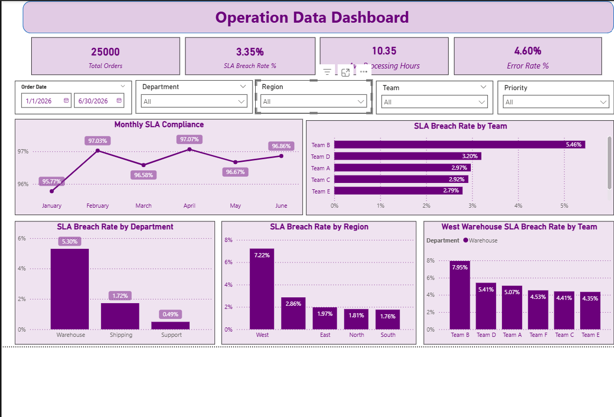

# Operations & SLA Performance Analysis

## About the Project

This is a personal data analytics project focused on analyzing order-processing performance.

The goal of the project was to simulate a real-world analyst assignment: starting with a business problem, preparing and validating operational data, analyzing performance using SQL and Python, and presenting the findings through an interactive Power BI dashboard.

The analysis focuses on **SLA compliance, processing time, operational errors, regional performance, departmental performance, and potential bottlenecks**.

---

## Dashboard

The Power BI dashboard provides an interactive view of:

* Total Orders
* SLA Breach Rate Percentage
* Average Processing Hours
* Error Rate
* Monthly SLA Compliance
* SLA Breach Rate by Region
* SLA Breach Rate by Department
* SLA Breach Rate by Team

<p align="center">
  
</p>

## Business Questions

The analysis was designed to answer:

* How many orders were processed?
* What percentage of orders met their SLA?
* How did SLA performance change over time?
* Which regions had the highest SLA breach rates?
* Which departments showed higher breach rates?
* Which teams showed elevated breach rates?
* Where should management focus further investigation?

---

## Dataset

The dataset is a **synthetic dataset created for this personal project**.

It contains order-level operational data covering **January–June 2026**.

The final cleaned dataset contains **25,000 unique orders** and includes fields such as:

* Order ID
* Order Date
* Region
* Department
* Team
* Priority
* Order Status
* Processing Hours
* Shipping Days
* Order Value
* Order Error
* SLA Hours
* Employee ID

---

## Tools & Technologies

* **Excel** — initial data profiling and data-quality checks
* **MySQL** — data validation and analytical queries
* **Python (Pandas, Matplotlib)** — exploratory data analysis and validation
* **Power BI** — KPI development and interactive dashboard
* **PowerPoint** — presentation of findings

---

## Data Cleaning & Validation

The raw dataset contained **25,012 records**.

The main data-quality issues identified were:

* 12 duplicate records
* Inconsistent Region formatting
* Missing values
* 4 negative Processing Hours values
* Several unusually high processing-time observations

The cleaning process included:

* Removing duplicate records
* Standardizing Region values
* Converting negative processing times to missing values because the true values were unknown
* Retaining extreme processing times rather than automatically deleting them, since they could represent genuine operational delays
* Excluding missing Processing Hours from SLA calculations

The final dataset contained **25,000 unique orders**.

---

## KPI Definitions

### SLA Compliance

An order was considered to have met SLA when:

`Processing Hours <= SLA Hours`

SLA compliance was calculated using only orders with valid processing-time values.

### SLA Breach

An order was classified as an SLA breach when:

`Processing Hours > SLA Hours`

### Error Rate

Error rate was calculated as:

`Orders with Order Error = Yes / Total Orders`

---

## Key Results

| KPI                     |      Result |
| ----------------------- | ----------: |
| Total Orders            |      25,000 |
| Valid Processing Orders |      24,968 |
| SLA Met                 |      24,132 |
| SLA Breached            |         836 |
| SLA Compliance          |      96.65% |
| SLA Breach Rate         |       3.35% |
| Average Processing Time | 10.35 hours |
| Error Rate              |       4.60% |

---

## Key Findings

### Regional Performance

The **West region** had an observed SLA breach rate of **7.22%**, substantially higher than the approximately 1.76%–1.97% range observed across the other named regions.

### Department Performance

**Warehouse** had the highest observed SLA breach rate among departments at **5.30%**, compared with 1.72% for Shipping and 0.49% for Support.

### West Warehouse

The **West Warehouse** operation had an observed SLA breach rate of **10.66%**.

Within West Warehouse, **Team B** had the highest observed breach rate at **20.86%**.

These results identify areas for further investigation but do not establish causation.

### Monthly Performance

Monthly SLA compliance remained relatively stable during the six-month period, ranging from approximately **95.77% to 97.07%**.

---


---

## Recommendations

Based on the analysis, the following areas would warrant further investigation:

1. **West Warehouse workflow** — investigate workload, queue times, process handoffs, and capacity.
2. **Team B** — compare workload, priority mix, order characteristics, and processing-time distributions with other teams.
3. **Long processing-time orders** — review extreme cases to determine whether they represent genuine operational bottlenecks.
4. **Data quality** — improve the completeness of Region, Team, Processing Hours, and Order Value fields.
5. **Ongoing monitoring** — continue tracking SLA compliance by month, region, department, and team.

---

## Project Structure

```text
Operations_Workflow_Analytics/
│
├── data/
│   └── operations_raw_data.xlsx
|   └── operations_cleaned.csv
│
├── sql/
│   └── operations_analysis.sql
│
├── python/
│   └── operations_analysis.py
│
├── powerbi/
│   └── Operations_data_Visual.pbix
│
├── screenshots/
│   └── dashboard.png
│
├── documentation/
|   └── Operation_Data_Documentation.pptx
|   └── Project_notes.txt
│
└── README.md
```

---

## What I Learned

This project helped me practice the end-to-end data analytics workflow, including:

* Translating a business problem into analytical questions
* Profiling and cleaning operational data
* Writing SQL queries for business analysis
* Using Python for exploratory data analysis and validation
* Designing meaningful KPIs
* Building an interactive Power BI dashboard
* Interpreting rates while considering their denominators
* Distinguishing unusual data from invalid data
* Communicating findings without making unsupported causal claims
* Translating analytical findings into business recommendations

